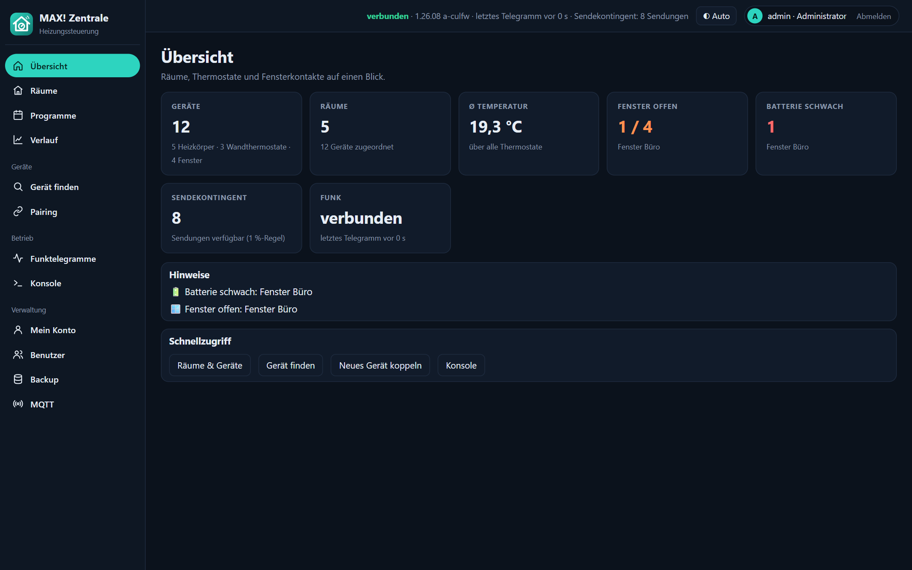
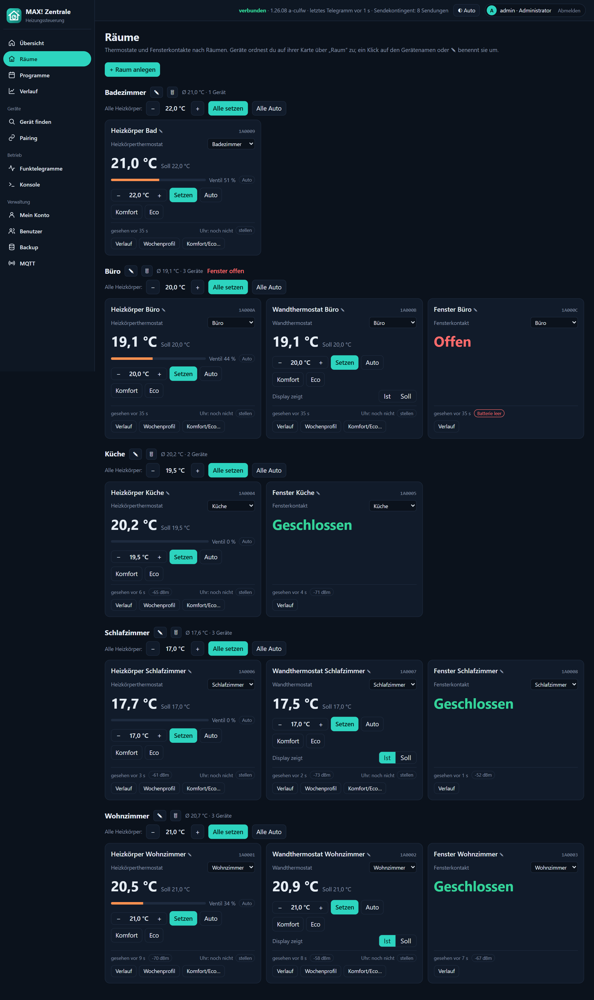
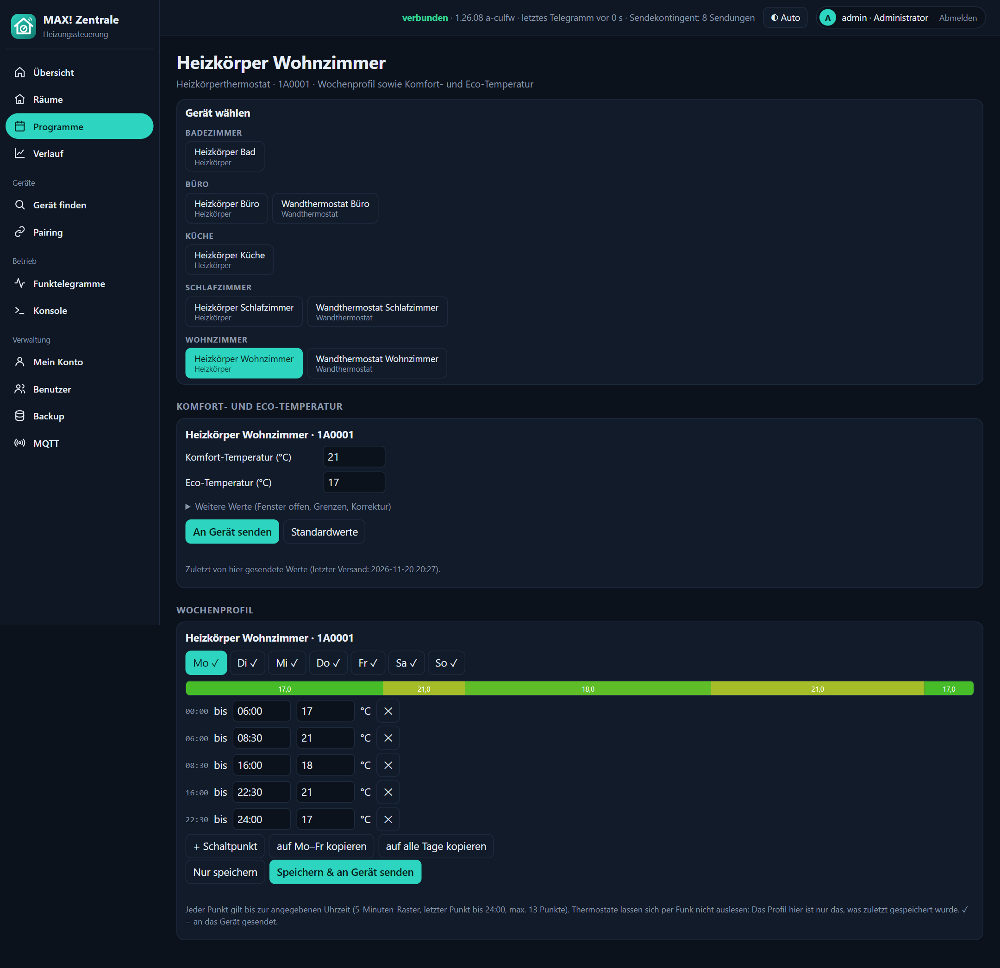
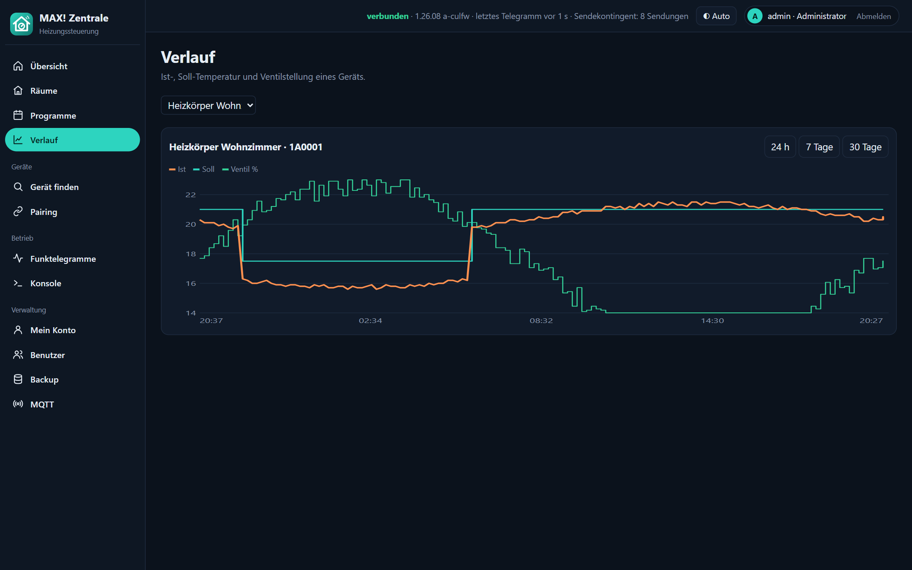
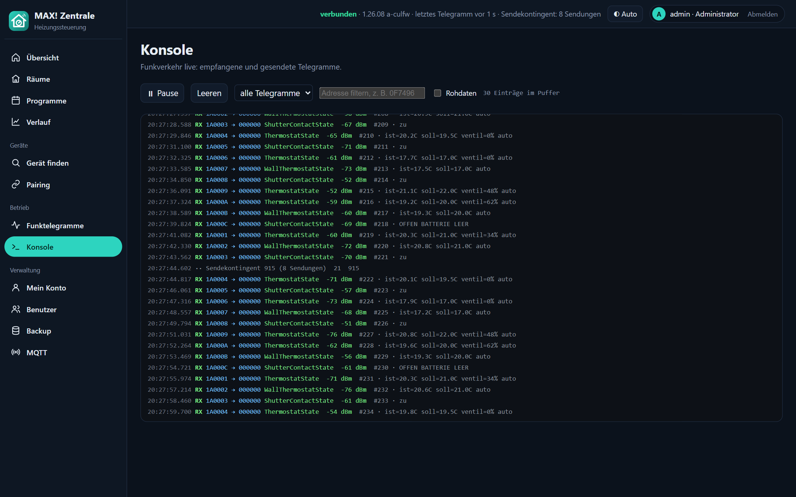

# MAX! Zentrale

**Eigene Steuerzentrale für ELV / eQ-3 MAX!-Heizungsgeräte – ohne Cloud, ohne ELV-Software.**

Heizkörperthermostate, Wandthermostate und Fensterkontakte des MAX!-Systems (868 MHz) weiter
nutzen, nachdem der Hersteller die Unterstützung eingestellt hat: Weboberfläche mit Räumen,
Wochenprogrammen, Verlaufsdiagrammen, Live-Funkkonsole, Benutzerverwaltung, Backups und
MQTT-/Home-Assistant-Anbindung. Läuft auf einem kleinen Linux-Rechner (Raspberry Pi, Proxmox-
Container, Docker, Windows) und braucht nur Python und einen Funkstick bzw. einen umgeflashten
MAX! Cube.



> *English summary:* a self-hosted replacement for the discontinued ELV/eQ-3 MAX! Cube software.
> It talks to a CUL-compatible 868 MHz transceiver (e.g. a MAX! Cube flashed with
> [a-culfw](https://github.com/heliflieger/a-culfw)) via USB serial or TCP and offers a web UI
> (German), room management, weekly profiles, history charts, a live RF console, user accounts
> with roles, database backups and MQTT with Home Assistant discovery. Pure Python standard
> library plus `pyserial`. The UI is in German; the protocol notes and code comments are
> mostly English.

## Funktionen

| | |
|---|---|
| **Räume & Geräte** | Geräte benennen und Räumen zuordnen, Raumsteuerung („Alle setzen“ / „Alle Auto“), Ist-/Soll-Temperatur, Ventilstellung, Batterie- und Fensterstatus |
| **Programme** | Wochenprofile je Heizkörper- oder Wandthermostat (bis 13 Schaltpunkte pro Tag), Komfort-/Eco-Temperatur, Fenster-offen-Temperatur, Grenzen, Offset |
| **Wandthermostate** | Soll-Temperatur setzen, Display auf Ist- oder Soll-Temperatur umstellen |
| **Pairing** | Neue oder zurückgesetzte Geräte koppeln, „Gerät finden“ (welches Gerät ist welches?) |
| **Uhrzeit** | Automatische Uhrzeitsynchronisation, wenn ein Gerät eine falsche Zeit meldet |
| **Verlauf** | Diagramme für Ist-, Soll-Temperatur und Ventilstellung (24 h / 7 Tage / 30 Tage) |
| **Konsole** | Live-Anzeige des Funkverkehrs (RX/TX) mit Filtern, dazu eine Liste der letzten Telegramme |
| **Benutzer** | Anmeldung, Rollen *Administrator*, *Bediener*, *Nur lesen*, Passwort-Hashing mit scrypt |
| **Backup** | Online-Sicherung der Datenbank (manuell und täglich automatisch), Download, Wiederherstellung |
| **MQTT** | Zustände und Befehle über MQTT, optional automatische Geräteanlage in Home Assistant |
| **Betrieb** | Dark-/Light-Modus, Handy-Ansicht, Docker-Image, systemd-Dienst, keine Abhängigkeiten außer `pyserial` |

## Schnellstart

Voraussetzung: ein 868-MHz-Funkgerät mit culfw (siehe [Installation](docs/installation.md#hardware)).

```bash
git clone https://github.com/okoebernik/max-zentrale.git
cd max-zentrale
pip install pyserial
python max_server.py --port /dev/ttyACM0 --http 8080          # Linux
# python max_server.py --port COM3 --http 8080                # Windows
# python max_server.py --port tcp://192.168.1.50:2323         # culfw über Netzwerk
```

Dann <http://localhost:8080> öffnen. Beim ersten Aufruf legst du den Administrator an
([Anmeldung](docs/screenshots/01-einrichtung.png)). Mehr dazu in der [Installation](docs/installation.md)
(Linux-Dienst, Docker, Proxmox).

**Ohne Hardware ausprobieren** – ein Simulator liefert Demo-Daten und beantwortet Befehle:

```bash
python tools/make_demo_db.py demo.db
python tools/sim_culfw.py --port 2323 &
MAX_PORT=tcp://127.0.0.1:2323 python max_server.py --db demo.db --http 8080
```

## Dokumentation

| Dokument | Inhalt |
|---|---|
| [Installation](docs/installation.md) | Hardware, Linux/Windows/Docker, systemd, Proxmox (LXC), Konfiguration |
| [Bedienung](docs/bedienung.md) | Alle Seiten der Oberfläche mit Screenshots |
| [MQTT & Home Assistant](docs/mqtt.md) | Topics, Payloads, Discovery, Beispiele |
| [Sicherheit & Betrieb](docs/sicherheit.md) | Anmeldung, Netzwerk, Backups, Aktualisieren |
| [Funkprotokoll](docs/protokoll.md) | Aufbau der MAX!-Telegramme, Funkregeln, Grenzen |
| [Entwicklung](docs/entwicklung.md) | Architektur, API, Simulator, Tests, Screenshots erzeugen |

## Ein paar Eindrücke

| Räume | Wochenprogramm |
|---|---|
|  |  |
| **Verlauf** | **Live-Konsole** |
|  |  |

## Wichtige Hinweise

* **Sendebegrenzung:** Im 868-MHz-Band darf ein Gerät nur 1 % der Zeit senden. Jede Sendung
  kostet rund eine Sekunde, das Kontingent füllt sich mit 1 Sekunde pro Sekunde wieder auf. Das
  Programm zeigt das Sendekontingent an und wartet, wenn es leer ist. Empfangen ist unbegrenzt.
* **Geräte lassen sich nicht auslesen:** Wochenprofile und Konfigurationswerte können über Funk
  nicht aus den Thermostaten gelesen werden. Angezeigt wird, was zuletzt von hier gesendet wurde.
* **Ein Steuergerät je Funknetz:** Die Geräte sind an eine Funkadresse gekoppelt. Die Software
  sendet mit der Adresse deines bisherigen Cubes (`--src`, Voreinstellung `10B240`), damit die
  vorhandenen Geräte weiter gehorchen. Näheres im [Funkprotokoll](docs/protokoll.md#absenderadresse).
* **Keine Verbindung zu ELV/eQ-3.** „MAX!“, „ELV“ und „eQ-3“ sind Marken ihrer Inhaber. Nutzung
  auf eigene Verantwortung; Funkgesetze (Duty Cycle) bleiben deine Sache.
* **Teststand:** Entwickelt und im Alltag getestet mit einem MAX! Cube (a-culfw 1.26.08,
  868 MHz), 6 Heizkörperthermostaten, 6 Wandthermostaten und 7 Fensterkontakten. Das Senden der
  erweiterten Konfiguration (Fenster-offen-Temperatur, Grenzen, Offset) ist an echten Geräten noch
  wenig erprobt. Die Docker-Variante ist bisher nicht gegen echte Hardware getestet.

## Mitwirken

Fehlerberichte und Pull Requests sind willkommen. Tests: `python -m unittest discover -s tests`.
Mehr in der [Entwicklungsdokumentation](docs/entwicklung.md).

## Danksagung

Das Wissen über das Funkprotokoll stammt aus der Arbeit der Community, insbesondere dem
[FHEM](https://fhem.de)-Modul `CUL_MAX` und der „Moritz“-Protokollbeschreibung; die Firmware für
den Cube/CUL stammt aus [a-culfw](https://github.com/heliflieger/a-culfw). Die Implementierung
hier ist eine eigenständige Neuentwicklung in Python.

## Lizenz

[MIT](LICENSE)
