# Bedienung

Alle Bilder zeigen die **Demo-Installation** mit erfundenen Geräten (siehe
[Entwicklung](entwicklung.md#simulator-und-demo-daten)). Die Oberfläche passt sich dem
Farbschema an (Umschalter *Auto / Hell / Dunkel* oben rechts) und ist auch auf dem Handy nutzbar.

Das Seitenmenü links gliedert sich in **Übersicht, Räume, Verlauf, Programme**, die Gruppe
**Geräte** (*Gerät finden*, *Pairing*, *Verknüpfungen*), die Gruppe **Betrieb** (*Alarme*, *Funktelegramme*, *Konsole*)
und die Gruppe **Verwaltung** (*Mein Konto*, *Benutzer*, *Backup*, *MQTT*). *Benutzer*, *Backup*
und *MQTT* sehen nur Administratoren.

Oben rechts steht der Funkstatus (verbunden, Firmware-Version, letztes Telegramm,
Sendekontingent), der Farbschema-Umschalter und dein Benutzer mit „Abmelden“.

* [Anmeldung](#anmeldung)
* [Übersicht](#übersicht)
* [Räume](#räume)
* [Programme](#programme)
* [Verlauf](#verlauf)
* [Gerät finden](#gerät-finden)
* [Pairing](#pairing)
* [Verknüpfungen](#verknüpfungen)
* [Funktelegramme](#funktelegramme)
* [Alarme](#alarme)
* [Konsole](#konsole)
* [Konto, Benutzer](#mein-konto)
* [Backup](#backup)
* [MQTT](#mqtt)
* [Hell-Modus und Handy](#hell-modus-und-handy)

## Anmeldung

Ohne Anmeldung ist nichts erreichbar. Die Sitzung hält 30 Tage (Cookie), nach fünf falschen
Passwörtern von derselben Adresse wird die Anmeldung für fünf Minuten gesperrt.

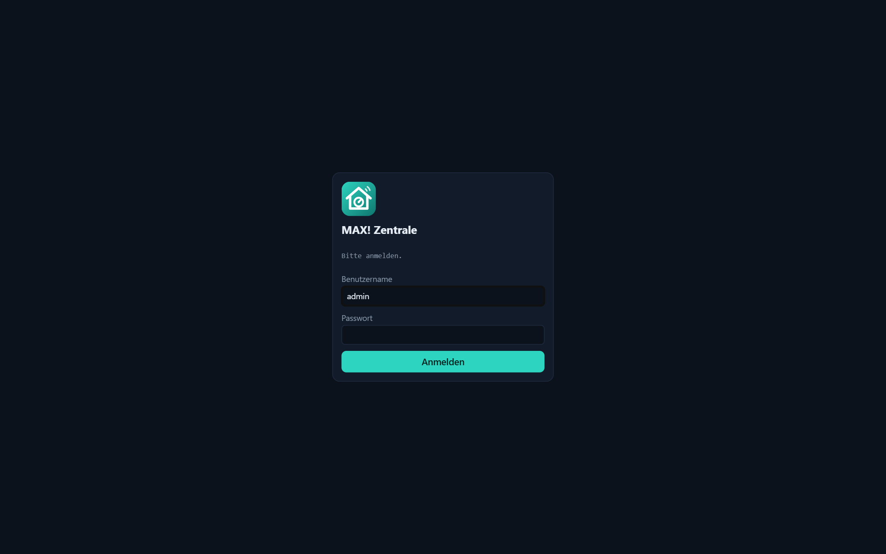

## Übersicht

Kennzahlen auf einen Blick: Anzahl der Geräte (Heizkörper, Wandthermostate, Fensterkontakte),
Räume, Durchschnittstemperatur, offene Fenster, schwache Batterien, Sendekontingent (wie viele
Sendungen jetzt möglich sind) und Funkstatus. Darunter die **Hinweise** – schwache Batterie,
offenes Fenster, Geräte, von denen seit über 6 Stunden nichts zu hören war, und unbenannte
Geräte – sowie Schnellzugriffe.

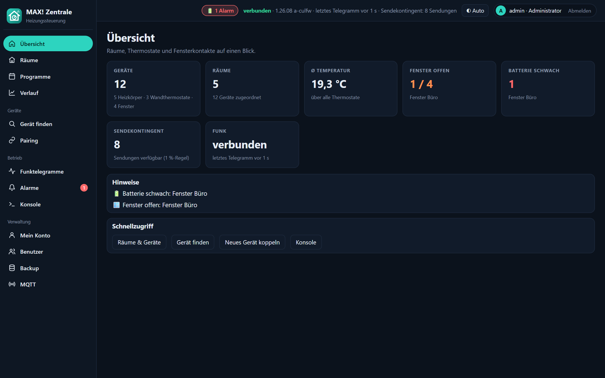

## Räume

Die Geräte sind nach Räumen gruppiert. Je Raum gibt es

* den Raumnamen mit **✎** (umbenennen) und **🗑** (Raum löschen, die Geräte bleiben erhalten),
  der Zusammenfassung (Durchschnittstemperatur, Anzahl Geräte) und dem Hinweis *Fenster offen*,
* darunter die **Raumsteuerung**: Temperatur wählen und **Alle setzen** (alle Heizkörper- und
  Wandthermostate des Raums) oder **Alle Auto** (zurück zum Wochenprogramm). Die Rückmeldung
  („alle bestätigt ✓“) erscheint rechts daneben.

**+ Raum anlegen** erstellt einen neuen Raum. Ein Gerät ordnest du über das Auswahlfeld auf
seiner Karte einem Raum zu; Geräte ohne Raum stehen unter *Nicht zugeordnet*.

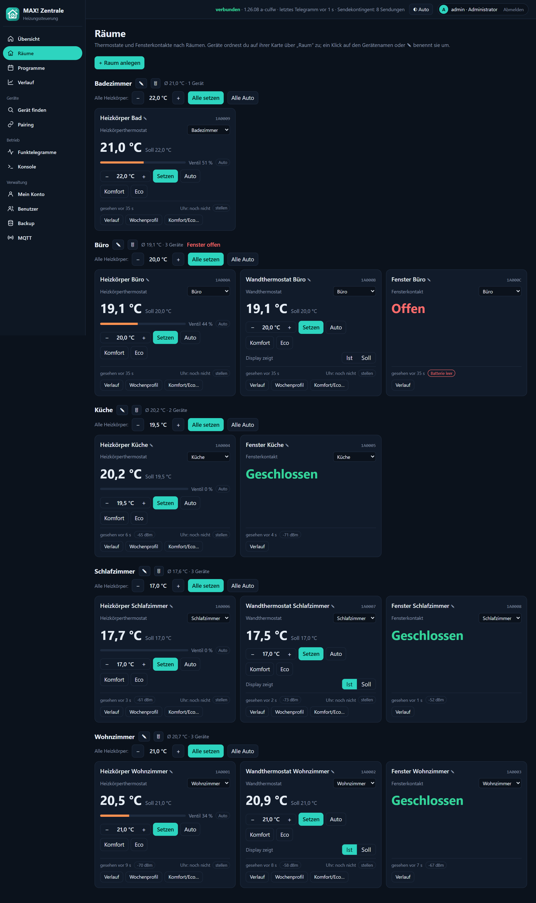

### Die Gerätekarten

* **Name** – Klick auf den Namen (oder ✎) vergibt einen eigenen Namen.
* **Typ und Raum** – der Typ wird aus den Telegrammen des Geräts erkannt, der Raum per Auswahlfeld
  gewählt.
* **Große Temperatur** – gemessene Ist-Temperatur (Heizkörperthermostate melden sie nur
  teilweise), daneben die Soll-Temperatur.
* **Ventilbalken** (Heizkörper) – Öffnung des Ventils in Prozent.
* **− / + / Setzen** – Soll-Temperatur in 0,5-°C-Schritten wählen und mit *Setzen* an das Gerät
  senden (manueller Modus). **Auto** schaltet zurück zum Wochenprogramm; **Komfort** und **Eco**
  setzen die jeweils gespeicherte Temperatur.
* **Display zeigt Ist | Soll** (Wandthermostat) – stellt um, was das Display des Wandthermostats
  anzeigt.
* **Fußzeile** – wann zuletzt etwas vom Gerät gehört wurde, die Uhr des Geräts (*stellen*
  synchronisiert die Uhrzeit sofort) und Batteriewarnung.
* **Verlauf / Wochenprofil / Komfort/Eco…** – springen zu den jeweiligen Seiten mit diesem Gerät.
* **Fensterkontakte** zeigen *Geschlossen* oder *Offen* (rot) und die Batterie.

Jeder Sendebefehl wird vom Thermostat bestätigt (Ack). Bleibt die Bestätigung aus, wird bis zu
dreimal wiederholt; danach erscheint eine Fehlermeldung auf der Karte.

## Programme

Hier legst du je Thermostat das **Wochenprogramm** sowie **Komfort-/Eco-Temperatur** fest. Oben
wählst du das Gerät (nach Raum gruppiert); die Buttons *Wochenprofil* und *Komfort/Eco…* auf den
Gerätekarten öffnen die Seite mit vorgewähltem Gerät.

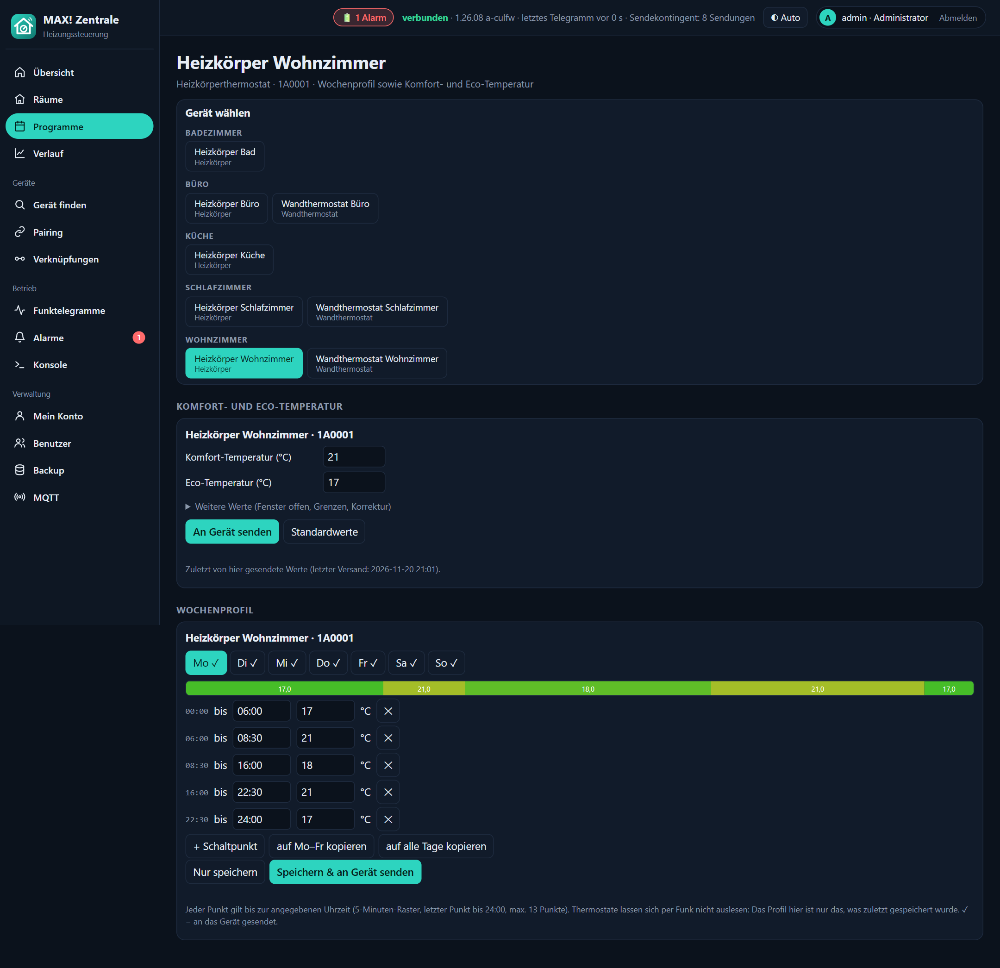

**Komfort- und Eco-Temperatur:** Die beiden Werte, die die Tasten *Komfort* und *Eco* verwenden.
Unter *Weitere Werte* stehen Fenster-offen-Temperatur und -Dauer, Maximal-/Minimaltemperatur und
der Temperatur-Offset (Korrektur des Fühlers). *An Gerät senden* überträgt die Werte,
*Standardwerte* setzt die Eingabe zurück.

**Wochenprofil:** Pro Wochentag bis zu 13 Schaltpunkte. Jeder Punkt gilt „bis“ zur angegebenen
Uhrzeit (5-Minuten-Raster, der letzte Punkt endet bei 24:00 Uhr). Die farbige Leiste zeigt den
Tagesverlauf. Hilfen: *Auf Mo–Fr kopieren*, *Auf alle Tage kopieren*. *Nur speichern* legt das
Profil in der Datenbank ab, *Speichern & an Gerät senden* überträgt es per Funk (mehrere
Sendungen, kann bei leerem Kontingent einige Minuten dauern; ein ✓ markiert gesendete Tage).

> Die Thermostate lassen sich per Funk nicht auslesen. Angezeigt wird das zuletzt **von hier**
> gespeicherte bzw. gesendete Profil.

## Verlauf

Diagramm für ein Gerät: **Ist-Temperatur** (orange), **Soll-Temperatur** (türkis, als Stufen) und
**Ventilstellung** (grün). Zeitraum 24 Stunden, 7 oder 30 Tage. Die Daten stammen aus den
empfangenen Telegrammen.

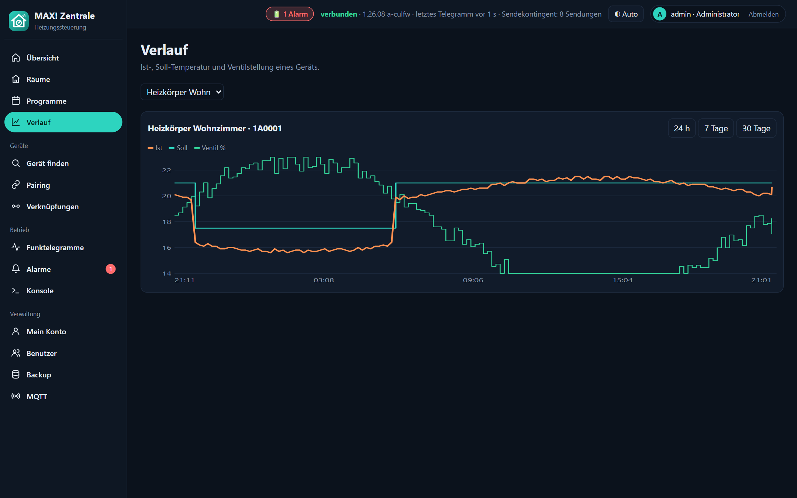

## Gerät finden

Du weißt nicht, welches Gerät hinter einer Adresse steckt? Suche starten und am Gerät etwas
auslösen: Drehrad am Heizkörper drehen, Fenster öffnen oder schließen, am Wandthermostat die
Soll-Temperatur ändern, Taster drücken. Das Gerät erscheint sofort in der Liste, du kannst ihm
direkt einen Namen und einen Raum geben.

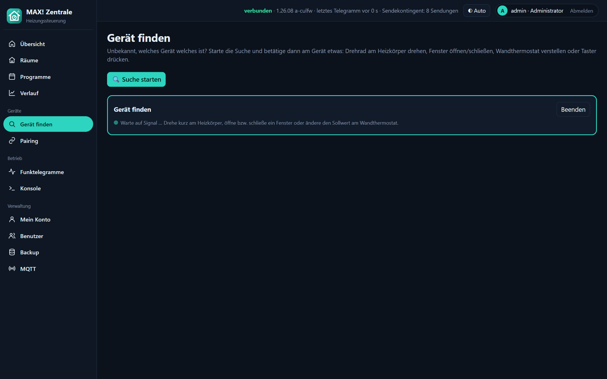

## Pairing

Neue oder zurückgesetzte Geräte koppelst du hier mit der Zentrale:

1. **Pairing starten** (der Modus läuft 120 Sekunden).
2. Am Gerät den Kopplungsmodus auslösen – das Vorgehen steht in der Anleitung des jeweiligen
   Geräts (Heizkörper-/Wandthermostat, Fensterkontakt; ein bereits gekoppeltes Gerät muss dazu
   meist erst zurückgesetzt werden).
3. Die Zentrale beantwortet die Anfrage des Geräts; der Fortschritt erscheint im Fenster
   („wird gesendet“, „gekoppelt“).

Antwortet das Gerät nicht, hängt das häufig am leeren Sendekontingent – dann steht „kein
Sendekontingent“ mit der Wartezeit da, und die Anfrage wird beim nächsten Ping des Geräts
wiederholt. Pairing hat Vorrang vor anderen Sendungen.

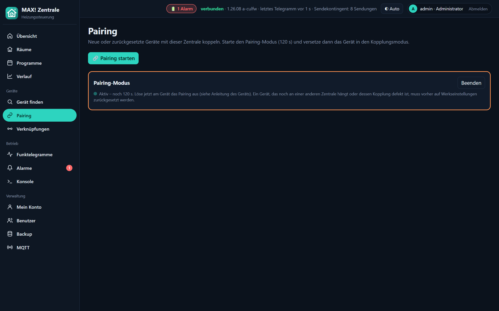

## Verknüpfungen

Ein Fensterkontakt kann direkt mit einem Heizkörperthermostat verknüpft werden. Öffnet sich das
Fenster, senkt das Thermostat selbständig die Temperatur (Fenster-offen-Temperatur, siehe
[Programme](#programme)) – auch wenn die Zentrale ausgeschaltet ist. Ebenso lässt sich ein
Wandthermostat mit Heizkörperthermostaten verknüpfen.

Auf der Seite wählst du links den Fensterkontakt (oder Wandthermostat), rechts das Thermostat und
klickst **Verknüpfen**. Die Zentrale sendet den Befehl nacheinander an beide Geräte und wartet
jeweils auf die Bestätigung; das kann bis zu einer Minute dauern (Sendekontingent). Ein
**Fensterkontakt** hört nur kurz nach seinem eigenen Senden zu: Die Zentrale wartet bis zu
5 Minuten, bis er sich meldet, und sendet dann sofort. Öffne oder schließe dazu das Fenster bzw.
drücke die Taste am Kontakt, solange die Seite „Warte auf den Fensterkontakt …“ zeigt. Lehnt ein
Gerät ab oder meldet sich der Kontakt nicht, bleibt die Verknüpfung im anderen Gerät bestehen (die
Zentrale nimmt nichts automatisch zurück, weil sie nicht weiß, ob die Verknüpfung vorher schon
bestand); mit **Lösen** lässt sie sich entfernen. Schlägt es fehl, einfach wiederholen. Ein Wandthermostat
und sein Heizkörper sind meist schon vom alten Cube verknüpft; ein erneutes Verknüpfen ist dann
nicht nötig und wird vom Heizkörper abgelehnt. Unter *Bestehende
Verknüpfungen* steht, was von hier aus gesetzt wurde; **Lösen** entfernt die Verknüpfung wieder.
Die Geräte lassen sich nicht auslesen – Verknüpfungen, die zuvor mit anderer Software gesetzt
wurden, erscheinen nicht in der Liste.

**Tipps bei Ablehnung:** Ein Heizkörper nimmt nur *ein* Wandthermostat als Partner an. Lehnt er
ein neues ab, hat er vermutlich noch einen alten Partner (z. B. aus der Zeit mit dem alten Cube).
Den alten Partner musst du vorher mit **Lösen** entfernen. Welche Partner ein Gerät hat, lässt sich
aus dem Funkverkehr der Konsole ablesen (siehe [Funkprotokoll](protokoll.md#erfahrungen-mit-verknüpfungen)).
Bei schwachem Empfang hilft es, den Heizkörper vor dem Verknüpfen am Drehrad kurz zu wecken.

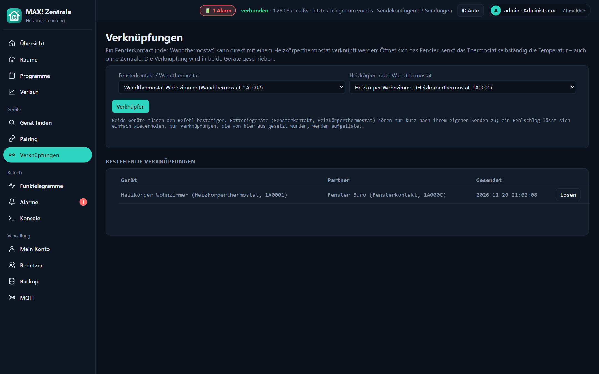

## Funktelegramme

Die zuletzt empfangenen 60 Telegramme als Tabelle (Zeit, Absender, Empfänger, Typ,
Signalstärke in dBm, Rohdaten der Nutzlast). Aktualisiert sich alle 5 Sekunden.

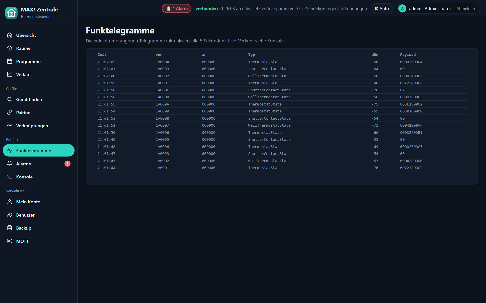

## Alarme

Meldet ein Gerät **„Batterie schwach“**, entsteht automatisch ein Alarm: oben in der Kopfleiste
erscheint ein roter Zähler („🔋 1 Alarm“), im Menü ein Zähler am Punkt *Alarme* und auf der
Übersicht ein Hinweis. Die Seite listet offene Alarme (Gerät, Raum, seit wann, wann zuletzt
gemeldet) und darunter den Verlauf der behobenen. Sobald das Gerät eine frische Batterie meldet,
endet der Alarm von selbst.

Administratoren können zusätzlich eine **E-Mail-Benachrichtigung** einrichten: SMTP-Server, Port,
Verschlüsselung (STARTTLS, SSL/TLS oder keine), Benutzer/Passwort, Absender und Empfänger (mehrere
mit Komma getrennt). Die Mail kommt, sobald der Alarm entsteht, und danach als Erinnerung im
eingestellten Abstand (Standard 24 Stunden), bis die Batterie getauscht ist. *Speichern &
Testmail senden* prüft die Einstellungen. Schlägt der Versand fehl, wird nach 15 Minuten erneut
versucht und der Fehler auf der Seite angezeigt. Das SMTP-Passwort liegt unverschlüsselt in der
Datenbank. Über MQTT steht der Batteriestatus jedes Geräts zusätzlich als Sensor bereit
([MQTT](mqtt.md)).

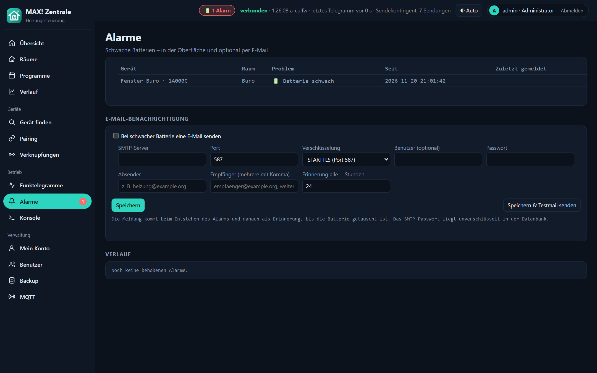

## Konsole

Der Funkverkehr **live**, Zeile für Zeile:

* **RX** (grün) empfangen, **TX** (orange) gesendet, **··** Meldungen des Funkgeräts (z. B.
  Sendekontingent).
* Je Zeile Zeit (mit Millisekunden), Absender → Empfänger, Telegrammtyp, Signalstärke, laufende
  Nummer und der entschlüsselte Inhalt (z. B. `ist=20.6C soll=21.0C ventil=34% auto`).
* **Pause / Weiter**, **Leeren**, Filter nach Richtung und Adresse, Schalter **Rohdaten** (zeigt
  zusätzlich das Roh-Telegramm und die Nutzlast).

Der Server hält die letzten 1 500 Einträge im Speicher; beim Öffnen der Seite erscheinen die
neuesten davon.

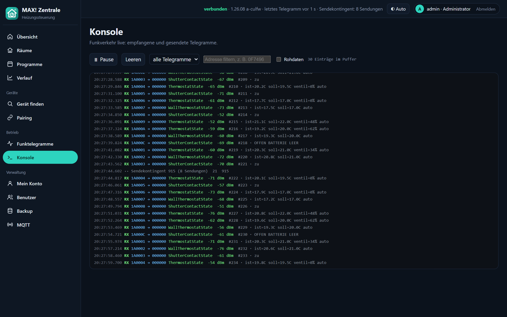

## Mein Konto

Passwort ändern (die Sitzungen auf anderen Geräten werden dabei beendet) und Abmelden.

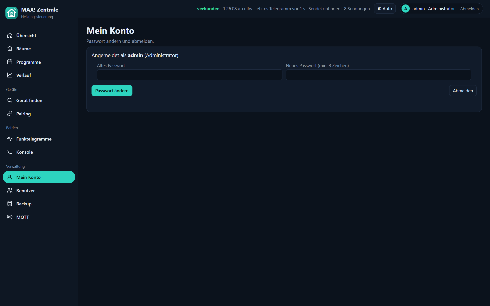

## Benutzer

*(nur Administratoren)*

Benutzer anlegen, Rolle ändern, Passwort zurücksetzen, löschen.

| Rolle | Darf |
|---|---|
| **Administrator** | alles, inklusive Benutzer, Backup und MQTT |
| **Bediener** | Thermostate steuern, Räume/Namen/Profile/Konfiguration ändern, Pairing |
| **Nur lesen** | alles ansehen (inkl. Konsole), nichts ändern |

Der letzte Administrator kann weder gelöscht noch herabgestuft werden, und man kann sich nicht
selbst löschen.

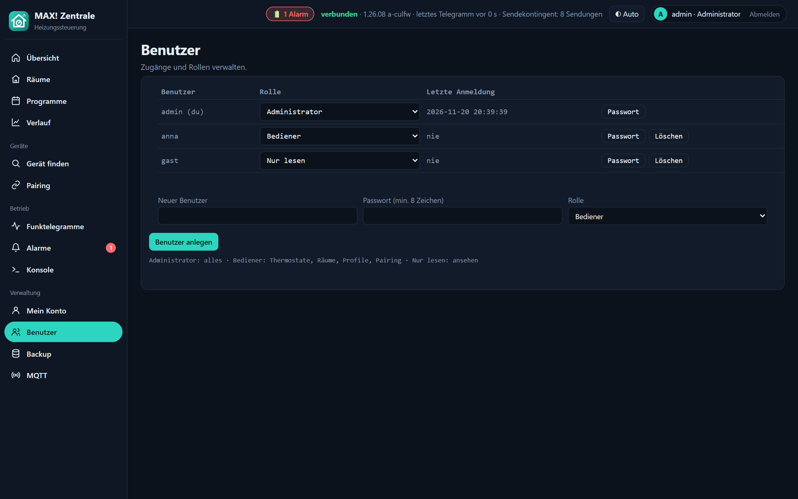

## Backup

*(nur Administratoren)*

* **Jetzt Backup erstellen** sichert die Datenbank im laufenden Betrieb konsistent.
* Die Liste zeigt jede Datei mit Zeitpunkt und Größe; **Herunterladen**, **Wiederherstellen**
  (der aktuelle Stand wird vorher als Backup `…-vorher.db` gesichert, danach lädt die Seite neu)
  und **Löschen**.
* **Automatik:** täglich ab 03:00 Uhr, standardmäßig werden die letzten 14 automatischen
  Backups behalten. Manuelle Backups werden nie automatisch gelöscht.
* Ablageort: im Ordner `backups` neben der Datenbank bzw. unter `MAX_BACKUP_DIR`.

Das Backup enthält **alles**: Namen, Räume, Profile, Verlauf, Benutzer (Passwort-Hashes) und das
MQTT-Passwort. Lade eine Kopie regelmäßig auf einen anderen Rechner herunter.

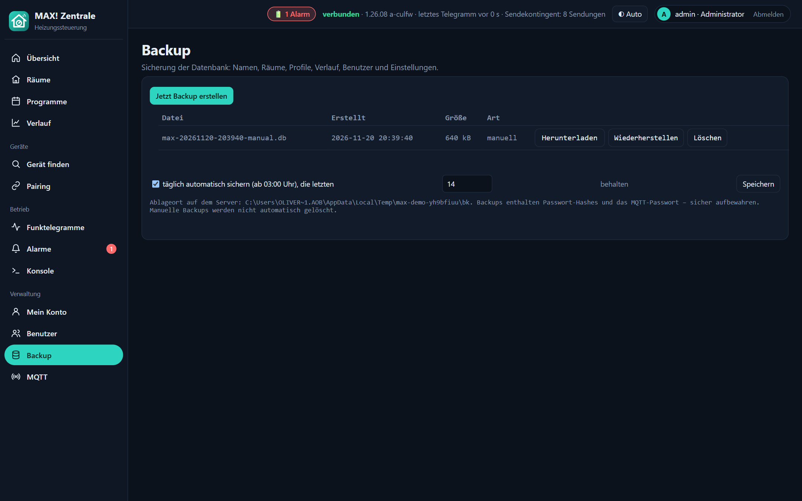

## MQTT

*(nur Administratoren)* – Broker, Port, Zugangsdaten, TLS, Basis-Topic und Home-Assistant-
Discovery einstellen. Die Statuszeile zeigt, ob die Verbindung steht. Details zu Topics und
Nutzdaten: [MQTT & Home Assistant](mqtt.md).

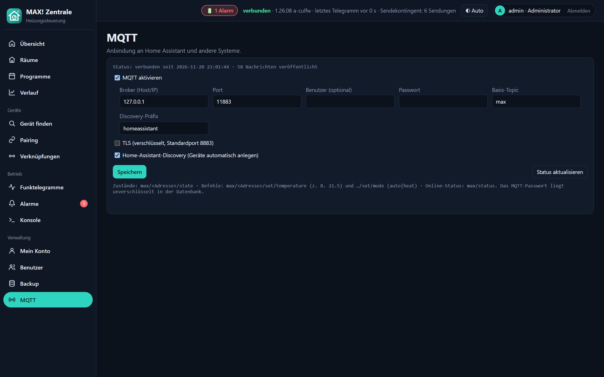

## Hell-Modus und Handy

| Hell | Handy |
|---|---|
| 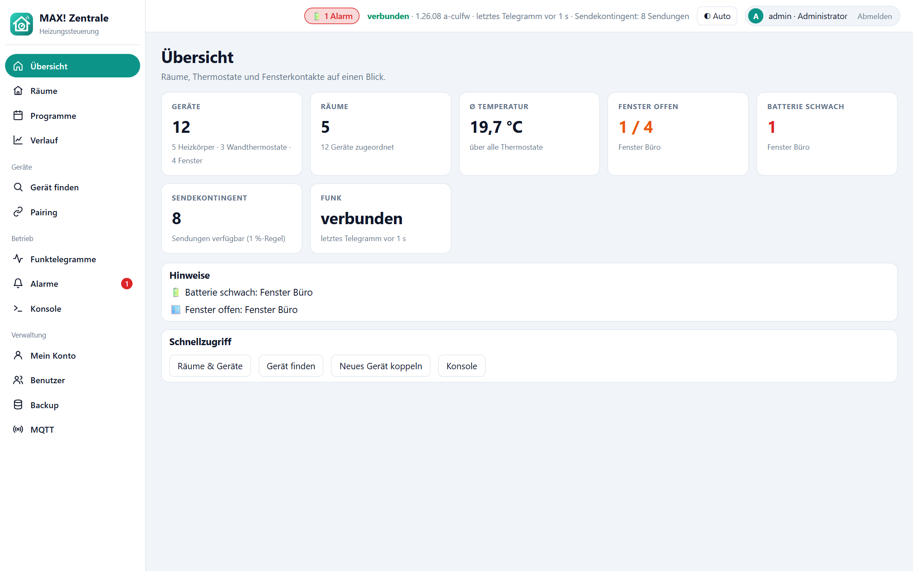 | 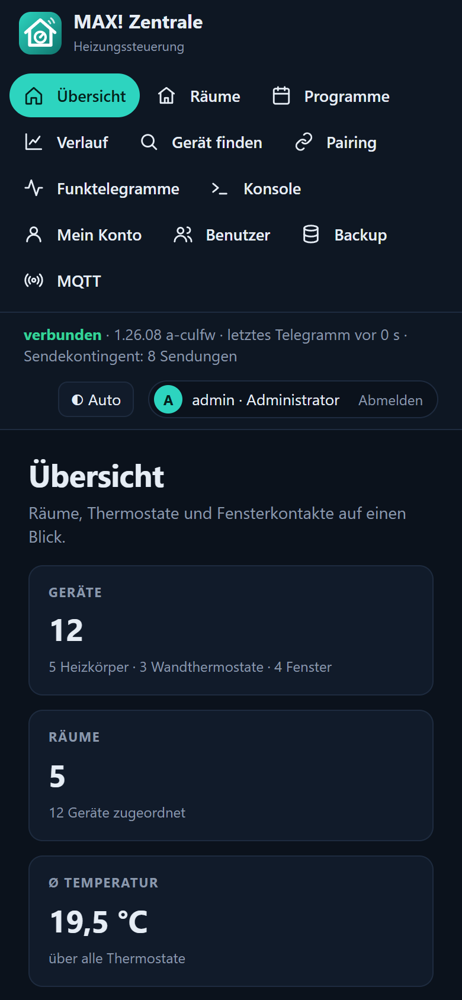 |

Unter 820 Pixeln Breite wandert das Menü nach oben. Der Raumbereich im Hellmodus:

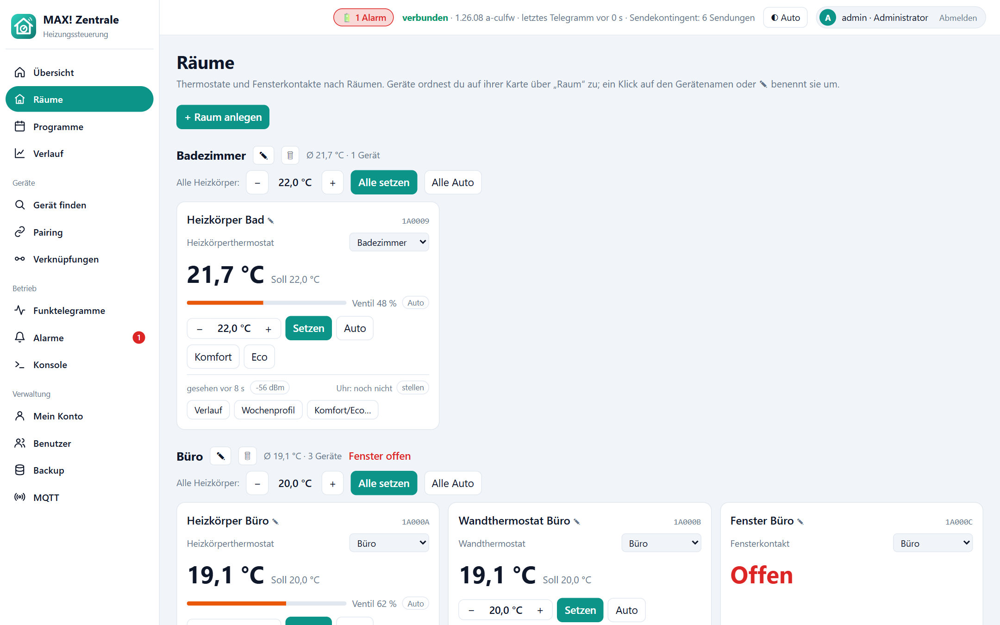
