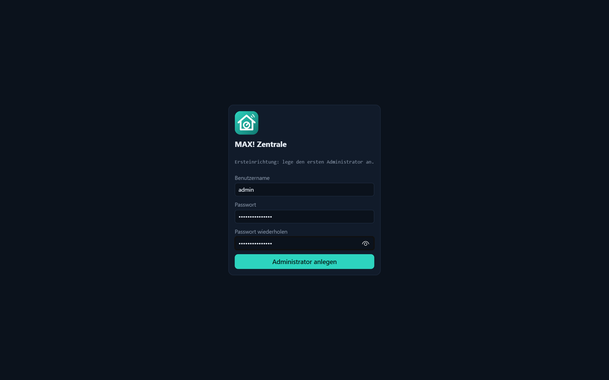

# Installation

## Hardware

Die Software spricht mit einem **868-MHz-Funkgerät mit culfw-Firmware** (CUL-Protokoll). Geeignet sind

* ein **MAX! Cube**, auf den [a-culfw](https://github.com/heliflieger/a-culfw) geflasht wurde
  (so wurde die Software entwickelt: Firmware `a-culfw 1.26.08`, Build `CUBEx4_81`, 868 MHz), oder
* ein CUL-kompatibler Stick (z. B. busware CUL868, nanoCUL868) mit culfw.

Wie du den Cube umflasht, steht in der Dokumentation von a-culfw bzw. in den FHEM-Foren („MAX!
Cube als CUL“). **Nach dem Flashen ist der Cube kein MAX!-Cube mehr**; die ELV-Software erreicht
ihn dann nicht mehr. Den Rückweg gibt es nur über die Original-Firmware – lies die Anleitung
vollständig, bevor du flashst.

Ob das Gerät funktioniert, prüfst du mit einem Terminalprogramm (38400 Baud) oder so:

```bash
python - <<'EOF'
import serial, time
s = serial.Serial("/dev/ttyACM0", 38400, timeout=1)
s.write(b"V\n"); time.sleep(1); print(s.read_all())     # Firmware-Version
s.write(b"Zr\n"); time.sleep(10); print(s.read_all())   # MAX!-Telegramme (Z0C81...)
EOF
```

`V` antwortet mit der Version (z. B. `V 1.26.08 a-culfw Build: 323 … CUBEx4_81 (F-Band: 868MHz)`),
nach `Zr` erscheinen Zeilen, die mit `Z` beginnen (z. B. `Z0C81044213B9C41356DE002AD916`), sobald ein
Gerät funkt – Thermostate melden sich alle paar Minuten.

### USB oder Netzwerk?

| Anbindung | Port-Angabe | Hinweise |
|---|---|---|
| **USB** (empfohlen) | `/dev/ttyACM0`, `COM3` | Zuverlässig. Beim Cube erscheint ein „AT91USBSerial“-Gerät (`03eb:6119`). |
| **Netzwerk** | `tcp://192.168.1.50:2323` | Der culfw-Netzwerkport funktioniert zum Senden/Konfigurieren, **lieferte beim Entwickeln aber nur unzuverlässig Empfangstelegramme**, solange kein Programm den USB-Port geöffnet hatte. Für den Dauerbetrieb USB nehmen. |

## Linux (systemd) – empfohlen

```bash
sudo apt install python3 python3-serial
sudo useradd --system --create-home --groups dialout max
sudo mkdir -p /opt/max /var/lib/max
sudo cp -r max_*.py web /opt/max/
sudo chown -R max: /var/lib/max
sudo cp deploy/max.service /etc/systemd/system/max.service
sudo systemctl daemon-reload
sudo systemctl enable --now max
```

Die Dienstdatei [`deploy/max.service`](../deploy/max.service) setzt `MAX_PORT`, `MAX_DB`,
`MAX_HOST` und die Zeitzone. Passe den Port an (`/dev/ttyACM0`, besser ein fester Name wie
`/dev/serial/by-id/usb-03eb_AT91USBSerial1-if00`). Danach: <http://SERVER:8080>.

Aktualisieren: Dateien erneut nach `/opt/max` kopieren und `sudo systemctl restart max`.
Die Datenbank (`/var/lib/max/max.db`) bleibt dabei erhalten; neue Tabellen legt die Software
selbst an.

## Windows

```powershell
pip install pyserial
python max_server.py --port COM3 --http 8080
```

Die COM-Nummer steht im Geräte-Manager unter „Anschlüsse (COM & LPT)“. Es darf nur *ein*
Programm den Port geöffnet haben – also nicht gleichzeitig ein Terminal oder die Entwicklungs-
Skripte `max_logger.py` / `max_send.py` verwenden.

## Docker

```bash
docker compose up -d --build
```

Die mitgelieferte [`docker-compose.yml`](../docker-compose.yml) bindet den Port an `127.0.0.1`
und nutzt standardmäßig den culfw-Netzwerkport. Für USB:

```yaml
    environment:
      MAX_PORT: /dev/ttyACM0
    devices:
      - /dev/ttyACM0:/dev/ttyACM0
```

Das Volume `max-data` enthält Datenbank und Backups (`/data`). Ändere die Portfreigabe nur
bewusst auf `0.0.0.0` – siehe [Sicherheit](sicherheit.md).

## Proxmox

Auf einem Proxmox-Host funktionierte in unserem Aufbau ein **LXC-Container** mit durch-
gereichtem USB-Seriell-Gerät zuverlässig:

```bash
# Container aus der Debian-Vorlage anlegen (ID, Netzwerk, Speicher anpassen)
pct create 107 local:vztmpl/debian-13-standard_13.1-2_amd64.tar.zst \
  --hostname max-ctrl --cores 1 --memory 512 --rootfs local-lvm:6 \
  --net0 name=eth0,bridge=vmbr0,ip=192.168.1.22/24,gw=192.168.1.1 \
  --unprivileged 1 --features nesting=1 --onboot 1
# Seriellen Port durchreichen (gid 20 = dialout im Container)
pct set 107 --dev0 /dev/ttyACM0,gid=20,mode=0660
pct start 107
pct exec 107 -- apt-get install -y python3 python3-serial
```

Danach die Dateien nach `/opt/max` im Container kopieren und den systemd-Dienst wie oben
einrichten (im Container als `root` ist keine `dialout`-Gruppe nötig).

Eine **virtuelle Maschine mit USB-Durchreichung** (`qm set <id> --usb0 host=03eb:6119`) lieferte
mit dem umgeflashten Cube keine Antworten: das Gerät erschien in der VM als `/dev/ttyACM0`,
nahm Befehle an, antwortete aber nicht (getestet mit xHCI, EHCI, UHCI, Geräte- und
Port-Durchreichung). Am Host selbst und im Container funktionierte dasselbe Gerät sofort. Falls
du eine VM brauchst, sind zwei Wege denkbar, die wir nicht getestet haben: den ganzen
USB-Controller per PCI-Passthrough durchreichen, oder auf dem Host `ser2net`/`socat` einsetzen
und in der VM per `tcp://` verbinden.

Hinweise:

* **Cube neu stecken**, wenn er nach Experimenten (VM-Durchreichung, Neustart) nicht mehr auf
  `V` antwortet: Netzteil/USB abziehen und wieder anstecken, danach den Dienst neu starten.
* **Sicherung** des Containers: Proxmox-Backup-Job anlegen, z. B. täglich um 02:30 Uhr:

  ```bash
  pvesh create /cluster/backup --id backup-max-ctrl --vmid 107 --storage local \
    --schedule "02:30" --mode snapshot --compress zstd \
    --prune-backups keep-daily=7,keep-weekly=4 --enabled 1
  ```

  Zusätzlich sichert die Software ihre Datenbank selbst (siehe [Backup](bedienung.md#backup)).

## Konfiguration

Kommandozeile und Umgebungsvariablen (`max_server.py`):

| Argument | Variable | Voreinstellung | Bedeutung |
|---|---|---|---|
| `--port` | `MAX_PORT` | `COM3` bzw. `/dev/ttyACM0` | Serieller Port oder `tcp://host[:port]` |
| `--db` | `MAX_DB` | `max.db` | SQLite-Datenbank |
| `--host` | `MAX_HOST` | `127.0.0.1` | Bind-Adresse; `0.0.0.0` für das ganze LAN |
| `--http` | – | `8080` | HTTP-Port |
| `--src` | – | `10B240` | Funk-Absenderadresse (die deines alten Cubes, 6 Hex-Zeichen) |
| – | `MAX_BACKUP_DIR` | `<Ordner der DB>/backups` | Ablage der Datenbank-Backups |
| – | `TZ` | System | Zeitzone für die Uhrzeitsynchronisation der Geräte |

### Die Absenderadresse (`--src`)

Gekoppelte Thermostate hören nur auf die Funkadresse „ihrer“ Zentrale. Wenn du die Geräte
weiter betreiben willst, ohne neu zu koppeln, trage die Adresse deines Original-Cubes ein (sie
steht auf dem Cube-Aufkleber bzw. in der Original-Software als RF-Adresse). Mit einer neuen
Adresse musst du jedes Gerät einmal neu koppeln – siehe [Pairing](bedienung.md#pairing).

## Erster Start

Beim ersten Aufruf der Seite erscheint die Einrichtung: Benutzername und Passwort (mindestens
8 Zeichen) des ersten Administrators festlegen. **Mach das sofort**, solange der Server im
Netzwerk erreichbar ist – bis dahin kann jeder den ersten Zugang anlegen.



Danach empfängt die Software Telegramme, legt unbekannte Geräte automatisch an (sie erscheinen
unbenannt) und du kannst sie [benennen und Räumen zuordnen](bedienung.md#räume).
