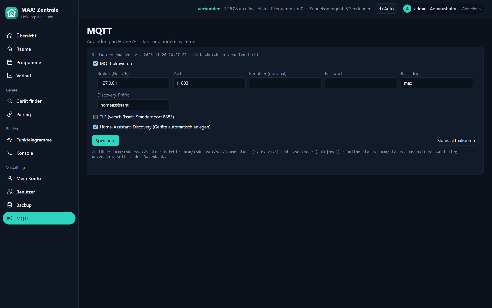

# MQTT & Home Assistant

Die Zentrale hat einen eingebauten MQTT-Client (MQTT 3.1.1, QoS 0, nur Python-Standardbibliothek).
Er veröffentlicht den Zustand jedes Geräts und nimmt Befehle für Thermostate entgegen.
Einrichten unter **Verwaltung → MQTT** (nur Administratoren).



| Einstellung | Bedeutung |
|---|---|
| MQTT aktivieren | Ein/Aus. Beim Speichern verbindet sich die Zentrale neu. |
| Broker, Port | z. B. `192.168.1.10`, `1883` |
| Benutzer / Passwort | optional. Das Passwort wird nie wieder angezeigt („gespeichert – leer lassen zum Behalten“) und liegt **unverschlüsselt** in der Datenbank (und damit in den Backups). |
| TLS | verschlüsselte Verbindung (Standardport 8883), Zertifikat wird gegen die Systemzertifikate geprüft |
| Basis-Topic | Präfix aller Topics, Voreinstellung `max` |
| Home-Assistant-Discovery | legt die Geräte in Home Assistant automatisch an |
| Discovery-Präfix | Voreinstellung `homeassistant` |

Bei Verbindungsabbruch versucht die Zentrale es mit wachsender Pause (3 s bis 60 s) erneut.

## Topics

`<base>` ist das Basis-Topic, `<adresse>` die sechsstellige Funkadresse des Geräts (z. B. `1A0001`,
im Programm bei jedem Gerät sichtbar).

| Topic | Richtung | Inhalt |
|---|---|---|
| `<base>/status` | Zentrale → Broker, *retained* | `online`; als Last Will `offline` bei Verbindungsverlust |
| `<base>/<adresse>/state` | Zentrale → Broker, *retained* | Zustand des Geräts als JSON |
| `<base>/<adresse>/set/temperature` | Broker → Zentrale | Solltemperatur, z. B. `21.5` (4,5 … 30,5 °C, wird auf 0,5 gerundet) |
| `<base>/<adresse>/set/mode` | Broker → Zentrale | `auto` (Wochenprogramm) oder `heat` / `manual` (manuell, mit der aktuellen Solltemperatur) |

Befehle werden nur für Thermostate (Heizkörper- und Wandthermostate) angenommen und laufen durch
dieselbe Warteschlange wie Befehle der Oberfläche: Sie werden per Funk gesendet, vom Gerät
bestätigt und müssen auf das Sendekontingent warten.

### Zustands-Nachricht

```json
{
  "name": "Heizkörper Wohnzimmer",
  "kind": "HeatingThermostat",
  "room": "Wohnzimmer",
  "temperature": 20.6,
  "setpoint": 21.0,
  "valve": 34,
  "mode": "auto",
  "ha_mode": "auto",
  "open": null,
  "battery_low": false,
  "rssi": -61.5,
  "last_seen": "2026-11-20T20:25:41"
}
```

| Feld | Bedeutung |
|---|---|
| `name`, `room` | wie in der Oberfläche vergeben (`null`, wenn nicht gesetzt) |
| `kind` | `HeatingThermostat`, `WallThermostat`, `ShutterContact`, `PushButton` |
| `temperature` | zuletzt gemessene Ist-Temperatur in °C (`null`, wenn unbekannt) |
| `setpoint` | Solltemperatur in °C |
| `valve` | Ventilöffnung in Prozent (nur Heizkörperthermostate) |
| `mode` | `auto`, `manual`, `vacation`, `boost` |
| `ha_mode` | `auto` oder `heat` (für Home Assistant abgeleitet) |
| `open` | Fensterkontakt: `true` = offen (sonst `null`) |
| `battery_low` | Batterie schwach |
| `rssi` | Empfangsstärke des letzten Telegramms in dBm |
| `last_seen` | Zeitpunkt des letzten Telegramms (lokale Zeit des Servers) |

Eine Nachricht erscheint, sobald sich der Inhalt eines Geräts ändert, und alle fünf Minuten
zur Auffrischung für alle Geräte.

### Beispiele

```bash
# alles mitlesen
mosquitto_sub -h 192.168.1.10 -v -t 'max/#'

# Wohnzimmer auf 22 °C
mosquitto_pub -h 192.168.1.10 -t max/1A0001/set/temperature -m 22

# zurück zum Wochenprogramm
mosquitto_pub -h 192.168.1.10 -t max/1A0001/set/mode -m auto
```

## Home Assistant

Mit aktivierter **Discovery** meldet die Zentrale beim Verbinden jedes bekannte Gerät unter
`<discovery-präfix>/<komponente>/max_<adresse>_<objekt>/config` an (retained). Home Assistant
legt daraufhin pro Gerät an:

| Gerät | Entitäten |
|---|---|
| Heizkörperthermostat | `climate` (Ist-/Solltemperatur, Modi *auto* und *heat*, 4,5–30,5 °C in 0,5er-Schritten), Sensor *Ventil* (%), Batterie, Empfang |
| Wandthermostat | `climate`, Batterie, Empfang |
| Fensterkontakt | `binary_sensor` *Fenster* (Klasse `window`), Batterie, Empfang |

Die Entitäten tragen den in der Oberfläche vergebenen Namen (sonst `MAX <Adresse>`), sind dem
Gerät `max_<adresse>` zugeordnet und werden durch `<base>/status` als verfügbar/nicht verfügbar
markiert. Neue Geräte erscheinen nach dem nächsten Telegramm automatisch; nach einer Umbenennung
meldet die Zentrale beim nächsten Verbinden neu an (Dienst neu starten oder MQTT einmal aus- und
einschalten).

Hinweis: Bei Wandthermostaten ist der Befehl „Solltemperatur“ ein *manueller* Sollwert wie in
der Oberfläche; zurück ins Wochenprogramm geht es mit dem Modus `auto`.

## Fehlersuche

* Statuszeile unter *Verwaltung → MQTT* zeigt „verbunden seit …“ oder die letzte Fehlermeldung
  (z. B. „Broker lehnt ab (Code 5: Benutzer/Passwort falsch)“).
* Auf dem Broker mit `mosquitto_sub -v -t '#'` prüfen, ob `max/status` ankommt.
* Ohne echten Broker kannst du `tools/sim_broker.py` als Gegenstelle nutzen – es bestätigt alles
  und gibt jede veröffentlichte Nachricht aus.
